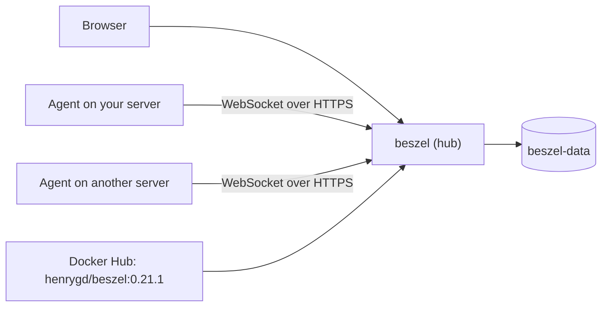

<div align="center">

# Beszel on Render

Lightweight server monitoring with historical data, Docker stats, and alerts. This repo deploys the Beszel **hub** (the dashboard). Agents run on the servers you want to monitor and report to it. The app runs from the official [Beszel](https://github.com/henrygd/beszel) image.

<p>
  <a href="https://render.com/deploy-template/api/github/start?template_repo=beszel">
    
  </a>
</p>

<p>
  <a href="https://render.com">
    
  </a>
  <a href="https://github.com/henrygd/beszel">
    
  </a>
  <a href="https://github.com/henrygd/beszel/blob/main/LICENSE">
    
  </a>
</p>

</div>

## What This Template Shows

This repository does not contain the Beszel source. The service pulls the official hub image from Docker Hub at a pinned version. To upgrade, change the tag in [`render.yaml`](./render.yaml) and push.

| Piece | Role |
| --- | --- |
| **[Beszel](https://github.com/henrygd/beszel)** | Hub: dashboard, alerts, and storage for metrics that agents send. |
| **`beszel`** ([Web Service](https://render.com/docs/web-services)) | The hub. |
| **`beszel-data`** ([Persistent disk](https://render.com/docs/disks)) | The PocketBase (SQLite) database at `/beszel_data`. |

## Architecture



### How It Works

1. Click **Deploy to Render**. The flow copies this repo into your GitHub account and applies [`render.yaml`](./render.yaml).
2. On Apply, enter `USER_EMAIL`. Render creates the disk and generates `USER_PASSWORD`.
3. On first boot, Beszel creates its database and an admin account from `USER_EMAIL` and `USER_PASSWORD`.
4. Sign in, add a system, and run the agent command the hub gives you on that server.

| Resource | Type | Plan | Notes |
| --- | --- | --- | --- |
| `beszel` | Web, image | Starter | Disk at `/beszel_data`, 1 GB. Health: `/api/health`. Single instance. |

Default region: **Oregon**.

## Quick Start

1. Click **Deploy to Render** above and enter `USER_EMAIL`.
2. Wait until `beszel` is **Live**.
3. Copy `USER_PASSWORD` from the service's **Environment** page and sign in at the service URL.
4. Click **Add System**. Copy the Docker or binary command the hub shows and run it on the server you want to monitor.

```bash
curl -fsS "https://<beszel>.onrender.com/api/health"
```

### Connecting agents

Agents open an outbound WebSocket to the hub over HTTPS, using the `HUB_URL` and `TOKEN` in the command the hub gives you. The monitored server doesn't need any inbound ports, so this works behind NAT and firewalls.

## Configuration

| Variable | Source | Description |
| --- | --- | --- |
| `USER_EMAIL` | Required | Admin email. Only used on first boot. |
| `USER_PASSWORD` | Generated | Admin password for the first sign-in. Change it in the UI afterward. |
| `APP_URL` | Wired | The service's `RENDER_EXTERNAL_URL`. Used in alert links and agent commands. Update it after you add a custom domain. |
| Others | Optional | OAuth-only login, MFA, and more. See [`.env.example`](./.env.example). |

`generateValue` runs once, on the first Blueprint apply. Alert notifications (email, Slack, Discord, and others) are set up in the hub's settings.

## Cost

Prices from [Render's pricing page](https://render.com/pricing).

| Resource | Approx. monthly |
| --- | ---: |
| `beszel` (Starter) | $7 |
| 1 GB disk | $0.25 |
| **Total** | **~$7.25** |

## Troubleshooting

| Problem | Solution |
| --- | --- |
| Admin sign-in fails | The account is created on first boot only. Use `USER_PASSWORD` from the **Environment** page, or the password you set in the UI. |
| Agent shows as down | Check that `HUB_URL` in the agent's config is the hub's public `https://` URL and that `TOKEN` matches the one the hub shows for that system. |
| Metrics disappear after a deploy | Confirm the disk is mounted at `/beszel_data`. |
| Deploy takes about a minute of downtime | Expected. A service with a disk stops the old instance before it starts the new one. Agents reconnect on their own. |

## Project Structure

```
render.yaml       Blueprint. One image-backed web service with a disk.
README.md         This file
LICENSE           Wrapper license
.env.example      Value the deploy form asks for, and optional extras
```

## Learn More

- [Blueprint spec](https://render.com/docs/blueprint-spec)
- [Beszel docs](https://beszel.dev)
- [Beszel on GitHub](https://github.com/henrygd/beszel)

## License

[MIT](LICENSE) for this wrapper. Beszel is also [MIT](https://github.com/henrygd/beszel/blob/main/LICENSE).
